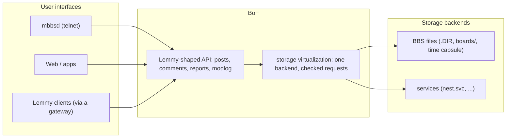

# BoF - Birds Of Feather

*The meta layer between BBS and community systems.*

> Birds of a feather flock together.

**BoF** is a new layer, designed and built from scratch by
**[Hung-Te Lin (piaip)](http://github.com/hungte/)**, that sits between the user
interfaces of a community -- a telnet BBS, a web front end, a Lemmy app -- and
the systems that keep its data. Every interface talks to its community through
the same small, well-defined API; every storage system serves the same API from
behind. People who gather around the same things (the birds of a feather) should
be able to meet whichever door they come in by.

BoF grew up inside [PTT BBS](https://github.com/ptt/pttbbs), the largest
BBS in Taiwan, as the way to take the BBS apart: to let the telnet UI
(`mbbsd`) stop reaching into files on disk, and to let the same boards be
served to modern community clients and, one day, to the Fediverse.

## Why

A classic BBS is one big program in which the user interface, the
business rules and the on-disk formats (`.DIR`, `boards/`, `.PASSWDS`, ...)
are woven together. That made it fast and robust for decades, but it also
means every new client must reimplement the BBS, and every change to the
storage must touch the UI.

BoF cuts the BBS in two:



## Design principles

- **Lemmy first.** The API follows [Lemmy](https://join-lemmy.org/docs/)
  (API v3): its entities (person, community, post, comment, post_like), its
  field and method names (`CreatePost`, `DeletePost`, `RemovePost`,
  `LockPost`, `CreateCommentLike`, ...), its ID semantics (global, stable,
  never reused) and its error names (`couldnt_find_post`, ...). A BBS that
  speaks Lemmy can be served to Lemmy clients and can federate.
- **Then Reddit, then Discourse.** What Lemmy cannot express follows
  Reddit (scores, crossposts, archived threads, ...), then Discourse (edit
  history, anonymous posting, slow mode, trust levels, ...). Only what none
  of them has is designed anew. BBS-only fields are prefixed with `bbs_`.
- **Identity is logical, layout is physical.** IDs and names follow
  Lemmy; how data is laid out on disk follows how it is used (for example,
  a post's comments are kept together, as a BBS shows them all at once).
- **In-process and fast.** For a telnet UI, BoF is a C library linked into
  the program, not a remote service: a key press must not wait for IPC.
  Gateways for other clients may expose the same API over the network.
- **One backend at a time, one API.** Below the API, the storage
  virtualization ([`include/bof_storage.h`](../include/bof_storage.h))
  calls one backend: the files of a classic BBS (`bof/fs/`), or a service
  such as `nest.svc` (Pebble and SQLite; `bof/nest/`, where nest.svc is). A
  backend may be made of others: nest.svc's keeps posts in nest.svc and
  the files of the boards as its cache, by calling the files backend
  itself ([`include/bof_fs.h`](../include/bof_fs.h)), so the two stay in
  step in one place rather than by a fan-out of writes. What the backend
  cannot do gives `bbs_storage_not_supported`. The checks of the actor
  and of the request are the API's (`bof/`), the same for any backend.
  The user interface does not know or care which backend it is.
- **Private stays private.** The real person behind an anonymous post,
  IP addresses and hidden boards are never exposed through BoF views.

## The API at a glance

The C API is declared in [`include/bof.h`](../include/bof.h). Every call
takes the actor (the authenticated local user) and a request struct, fills
a response struct, and returns a `bof_error_t`:

```c
bof_actor_t me = { .name = "piaip", .from = "140.112.1.1" };
bof_remove_post_t req = { .post = ref, .removed = 1, .reason = "spam" };
bof_post_result_t res;

bof_error_t err = bof_remove_post(&me, &req, &res);
if (err != BOF_OK)
    printf("failed: %s\n", bof_error_name(err));   /* e.g. couldnt_find_post */
```

| Area | Lemmy | BoF |
|---|---|---|
| Errors | `couldnt_find_post`, ... | `bof_error_t`, `bof_error_name()` |
| People | `person`, `local_user`, `GetPersonDetails` | `bof_person_id_t`, `bof_actor_t`, `bof_person_t`, `bof_get_person()` |
| Communities | `community`, `GetCommunity`, `ListCommunities`, `CreateCommunity`, `EditCommunity`, `RemoveCommunity` | `bof_community_t`, `bof_get_community()`, `bof_list_communities()`, `bof_bbs_community_id()`, `bof_create_community()` and `bof_edit_community()` (with the whole board header, `boardheader_t`), `bof_remove_community()`; renaming, merging and rebuilding boards: `bof_bbs_rename_community()` (as Discourse renames a category), `bof_bbs_merge_communities()` (as Discourse moves topics), `bof_bbs_rebuild_community()` |
| Rules | checked in each call (bans, locked posts, moderators) | `bof_bbs_can_read()` (`bof_bbs_can_read_at()` for the lists of boards), `bof_bbs_can_post()`, `bof_bbs_can_comment()`, `bof_bbs_is_moderator()`, `bof_bbs_may_moderate()` (with Discourse's category moderators: `bof_bbs_group_roles()`); checked by the API for an actor with `bbs_person` |
| IDs | `post.id`, `comment.id` (nest.svc's: a serial; the post and floor) | `bof_post_id_t`, `bof_comment_id()`, `bof_bbs_get_post_id()`, `bof_bbs_get_post_key()`, `bof_bbs_find_post()` |
| Posts | `CreatePost`, `EditPost`, `DeletePost`, `RemovePost`, `LockPost`, `FeaturePost` | `bof_create_post()`, `bof_edit_post()`, `bof_delete_post()`, `bof_remove_post()`, `bof_lock_post()`, `bof_feature_post()`; restoring from the archive is `bof_bbs_restore_post()` (as Discourse's recover), not `deleted: false` / `removed: false` |
| Reading | `GetPosts`, `GetPost`, `MarkPostAsRead` | `bof_get_posts()`, `bof_get_post()`, `bof_mark_post_as_read()` |
| Comments | `CreateComment` (+ `CreatePostLike` for a push or boo), `GetComments`, `EditComment`, `DeleteComment`, `RemoveComment`; Discourse's `post_revisions` | `bof_create_comment()`, `bof_get_comments()`, `bof_edit_comment()`, `bof_delete_comment()`, `bof_remove_comment()`, `bof_get_comment_revisions()` |
| Reports | `CreatePostReport`, `CreateCommentReport`, `ListReports`, `Resolve*Report` | `bof_create_report()`, `bof_list_reports()`, `bof_resolve_report()` |
| Modlog | `GetModlog`, `mod_*` | `bof_modlog_*()`; moderation calls take their record |
| Bulk | Discourse's bulk delete | `bof_remove_posts()` |
| BBS only | - | `bof_bbs_set_post_modes()`, `bof_bbs_reset_post_score()`, `bof_bbs_mask_post()`, `bof_bbs_remove_crosspost()`; the content: `bof_bbs_get_post_file()` (to read), `bof_bbs_get_post_body()` (to edit), `bof_bbs_name_post()`, `bof_bbs_format_post_header()`, `bof_bbs_format_post_origin()`, `bof_bbs_format_comment()` and `bof_bbs_comment_width()` (the line of a comment; `bof_create_comment()` makes it from the text alone); the time capsule: `bof_bbs_get_post_revisions()`, `bof_bbs_get_post_revision_file()`, `bof_bbs_list_post_revisions()`, `bof_bbs_list_archived_posts()` (Discourse's `post_revisions`) |

The API grows one feature at a time, as `mbbsd` moves onto it.

## Gateways

A program other than the BBS, such as a Lemmy API server in front of it,
uses BoF the same way `mbbsd` does:

- **Linking and opening.** Link `bof/libbof_gateway.a` (BoF with the
  globals the programs of the BBS define themselves) and the libraries in
  `common/`, include [`include/bof_gateway.h`](../include/bof_gateway.h),
  and call `bof_gateway_open()` once: it enters `BBSHOME` and attaches the
  board cache of the running BBS.
- **One call at a time.** BoF is not thread-safe (the date functions of
  the common library, the backend in use, the read records of a
  session): a server serializes its calls (one lock) or runs them in
  worker processes. The read records (`readmarks.c`) are those of one
  person at a time: before the calls of a user, a gateway makes them its
  person with `bof_bbs_read_marks_switch()`, which saves those of the
  one before (keeping the calls of one person together saves loading
  them again).
- **IDs.** Lemmy's IDs are nest.svc's, so a gateway needs it as the
  backend. A post ID gives its key (`bof_bbs_get_post_key()`), the key
  where it is now (`bof_bbs_find_post()`), which makes the
  `bof_post_ref_t` the other calls take; a comment ID is its post and
  floor (`bof_comment_id_split()`); `bof_bbs_community_id()` gives the ID
  of a community.
- **Who.** `bof_get_person()` gives the person of the authenticated user;
  an actor with it (`bbs_person`, with `name`, `from` and
  `bbs_local_user`) has BoF check the rules of the BBS on each call, as
  Lemmy does, and take nothing about a post from the request but its
  board and file name: the list is the board's, the record is read again
  from it, a new post or comment is the actor's (from its title and body,
  or from what was typed), and an edited body comes from `tmp/`. The
  reads take no actor: before listing or reading, check
  `bof_bbs_can_read()`. For any caller, names and lists must stay in
  their board (`bof_bbs_valid_post_file()`).
- **Texts.** The files are in Big5 (with ANSI colors): a gateway converts
  to and from UTF-8. A new post is given by its body alone
  (`bof_create_post_t.body`), which BoF writes as the editor of the BBS
  would; posts are read from `bof_bbs_get_post_file()`.
- **Errors.** `bof_error_name()` gives Lemmy's names (`{"error": ...}`);
  the BBS's own are `bbs_`-prefixed.

| Lemmy | BoF |
|---|---|
| `GET /community`, `/community/list` | `bof_get_community()`, `bof_list_communities()` |
| `POST /community`, `PUT /community` | `bof_create_community()`, `bof_edit_community()` |
| `POST /community/remove` | `bof_remove_community()` |
| `GET /user` | `bof_get_person()` |
| `GET /post/list`, `/post` | `bof_get_posts()`, `bof_get_post()`, `bof_bbs_get_post_file()` |
| `POST /post`, `PUT /post`, `/post/delete`, `/post/remove`, `/post/lock`, `/post/feature` | `bof_create_post()`, `bof_edit_post()`, `bof_delete_post()`, `bof_remove_post()`, `bof_lock_post()`, `bof_feature_post()` |
| `GET /comment/list`, `POST /comment`, `PUT /comment`, `/comment/delete`, `/comment/remove` | `bof_get_comments()`, `bof_create_comment()`, `bof_edit_comment()`, `bof_delete_comment()`, `bof_remove_comment()` |
| `POST /post/like` | `bof_create_post_like()` (nest.svc) |
| `/post/report`, `/comment/report`, `/report/list`, `/*/report/resolve` | `bof_create_report()`, `bof_list_reports()`, `bof_resolve_report()` |
| `POST /post/mark_as_read` | `bof_mark_post_as_read()` (one person per process) |

## Status and roadmap

BoF is new. It is being introduced into PTT BBS step by step, each step
keeping the BBS working exactly as before:

1. **Skeleton** -- library, error names, tests. *(done)*
2. **Posts** -- all the writes of posts on boards *(done)*; digests stay in
   `mbbsd`, as Lemmy has none.
3. **Comments, reports, modlog** *(done)*.
4. **Listings** -- the post list and read records *(done)*.
5. **Storage virtualization** -- the files backend behind it *(done)*;
   `pttbbs.conf` picks the default backend (`BOF_DEFAULT_STORAGE`). The
   `nest.svc` backend (`bof/nest/`) is there, off unless a site turns
   nest.svc on (`CONFIG_NEST`): nest.svc is the database, and the files of the boards are
   its cache, which BoF reads directly.
6. **Communities** -- boards and moderators: read *(done)*; the board
   headers (`.BRD`) written through BoF, and removing, renaming, merging and
   rebuilding boards *(done)*; `mbbsd` and the utilities (`util/`) write
   `.BRD` only through BoF.
7. **People** -- accounts read *(done)*; in a database, with Lemmy person
   IDs, next.
8. **Gateways** for Lemmy clients.

## Lineage

The idea of BoF goes back to piaip's earlier design notes for a successor
to PTT BBS ("The New Architecture" and the "BOF 1.0 API Spec"). Several of
their ideas carry on here, now expressed in Lemmy's terms:

- Every entity has a sequential, enumerable ID per type (users, forums,
  posts), and deletion is a mark inside the item rather than a removal --
  as Lemmy's serial IDs and its `deleted`/`removed` flags.
- A user is separate from the name it shows, with a display name and a
  status line -- as Lemmy's `person.name` and `display_name`.
- A trust ("credit") system earned by logging in and posting, replacing
  PTT's many posting limits -- as Discourse's trust levels.
- API namespaces for users, friend requests, sessions, forums and groups.

## Building and testing

Inside the PTT BBS tree, BoF is built with the rest of it:

```sh
make -C bof         # builds libbof.a
make -C bof test    # runs the tests
```

The sources are in three parts:

| Directory | What | Header |
|---|---|---|
| `bof/` | The core: the API, its checks and the backend in use (`storage.c`), communities and persons (`people.c`), the rules of the BBS (`policy.c`), the records of the modlog (`modlog.c`), the read records (`readmarks.c`), error names (`bof.c`), opening for gateways (`gateway.c`) | [`include/bof.h`](../include/bof.h), [`include/bof_storage.h`](../include/bof_storage.h), [`include/bof_gateway.h`](../include/bof_gateway.h) |
| `bof/files/` | The files of a BBS, as primitives with no actor or rules: records of lists, the content of posts, the line of a comment, aggregate boards, the time capsule | [`include/bof_files.h`](../include/bof_files.h) |
| `bof/fs/` | The files backend (`bof_storage_files`): the calls of the API done with the files | [`include/bof_fs.h`](../include/bof_fs.h) |
| `bof/nest/` | The nest.svc backend (`bof_storage_nest`): nest.svc, with the files backend as its cache; not the default | [`include/bof_storage.h`](../include/bof_storage.h) |

BoF sources are plain ASCII C (Big5 texts are macros in
`include/common.h`); they use the shared headers in `include/` and the
libraries in `common/`, through `bof_int.h`. They do not include the
headers of mbbsd (`bbs.h`, `proto.h`, `var.h`), so they cannot use the
globals of a session (the current user, board, SHM): callers pass what
BoF needs. The exception is the records of posts read (`readmarks.c`),
which BoF keeps for the person in session, one per process, as the BBS
always has. The board cache (shared memory) and the accounts are
site-wide, not of a session: BoF reads communities and persons from them
(`people.c`).

## Author

BoF is designed and written by [Hung-Te Lin (piaip)](http://github.com/hungte)
[<hungte@gmail.com>](mailto:hungte@gmail.com).

## License

BoF is dual-licensed: you may use it under either the
[BSD 2-Clause License](LICENSE) or the
[GNU General Public License, version 2](COPYING.GPL-2), at your choice
(SPDX: `BSD-2-Clause OR GPL-2.0-only`). See [LICENSE](LICENSE).

The exception is `readmarks.c` (the records of posts read), moved from
`mbbsd/brc.c` of PTT BBS, which has several authors: it is only under the
GNU General Public License, version 2, as the rest of PTT BBS, until it
is rewritten; so is its test (`tests/test_readmarks.c`), which includes
it.
